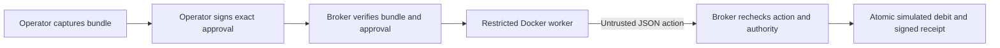

# Enforced executor: first integrated experiment

We can now test a specific boundary: an untrusted Node tool proposes one synthetic purchase, while a host broker independently decides whether that exact action can affect a local ledger. This increment builds on the existing artifact/policy demonstrations without changing their APIs or the original HTTP simulator.

## Before and after

The original `tools/trust.mjs` gate returns a decision using declared inputs and an unsigned local approval. Calling it is optional and it does not control execution. The new flow puts a broker in control of the only supported effect:

The worker has no broker database, signing keys, host credentials, Docker socket or host network. It receives the approved action as JSON on stdin and emits one JSON action on stdout. Worker-supplied approval flags, identities, receipts and ALLOW statements have no authority.

## Artifact and approval contract

`captureBundle(directory, {entrypoint, runtimeImage})` embeds bounded file bytes into a JSON bundle with each path/hash, entrypoint and immutable local Docker image ID. `validateBundle` recomputes file and bundle digests. Unsafe paths, symlinks and special files are rejected; root `.git` is excluded. Dependencies are not resolved or fetched: execution uses captured files and the reviewed runtime. Static inspection checks those captured bytes. HIGH findings block approval; REVIEW findings require acknowledgement. These heuristics are not malware-free guarantees.

`issueApproval(bundle, options)` signs a strict envelope with an operator-controlled Ed25519 key. It binds bundle digest, approval ID, signer key ID, worker principal, policy version, the complete action, issued-at and expiry. Maximum lifetime is one hour. Signing does not establish that a human made the decision; the demo creates automated sample approvals.

The action is exactly `{tool: 'simulate_purchase', amountCents, currency: 'USD', vendor: 'approved-tools', purpose}`. Amounts are positive safe integers in cents. The broker exposes no generic shell, URL proxy or payment-provider adapter.

## Broker and persistence

The trusted host configures `EnforcedBroker` with expected principal, policy version, approval public keys, per-action cap, initial simulated budget and receipt keys. Principal identity comes from that launch configuration and the owned worker pipe, not a worker field. This is a single-operator local interface, not multi-user network authentication.

`execute(bundle, approval)` snapshots inputs before asynchronous work. It checks signature, scope, expiry, revocation and limits before launch, then requires parsed worker output to match the signed action exactly. It rechecks authority and budget after execution under the SQLite write transaction that records the simulated effect. Revocation or expiry during a worker run prevents its eventual debit.

Approval IDs are unique in the ledger. A successful valid replay returns the stored receipt; reusing an ID with separately signed changed data conflicts. Independent broker instances share the SQLite budget and revocations. Changing the configured initial budget cannot refill an existing principal. Separate processes may each run an isolated worker, but only one matching simulated effect can commit for an approval ID.

`revokeApproval(id)` and `revokeKey(id)` are trusted host operations persisted in the ledger. This is local revocation state, not a distribution service. Applications can supply a persistent database and stable receipt keys; the sample demo deliberately uses fresh in-memory state and keys.

## Trust and isolation limits

We trust the broker process, operator decisions and keys, trust-root configuration, policy, ledger storage, runtime image, Docker daemon and host kernel. Tool bytes/output and supplied bundle/approval files are untrusted inputs until validated. A valid signature establishes approval origin and integrity under the configured key, not code safety.

The Docker worker runs nonroot with no network, a read-only root and bundle mount, dropped capabilities, no-new-privileges, resource limits and a bounded temporary filesystem. It can still modify temporary files and emit arbitrary output. These controls apply to the supported Linux Docker path; they are not proof against kernel/container escapes. If the threat includes compromising the Docker host, privileged effects need an independent host/VM/service boundary. There is no Node VM or permission-flag fallback when Docker is unavailable.

The image ID is approved with the bundle, but identifying an image does not establish its trustworthiness. Review runtimes separately. The local builder records Node/library hashes; it does not establish vendor signing or SLSA provenance. Native code inside an approved bundle/runtime remains part of that review and isolation trust model. Host snapshot storage must be inaccessible to untrusted local users.

## Evidence and failure

The simulated debit and receipt commit together. A crash before commit leaves no committed debit; after commit, the trusted operator can recover the record or replay a still-valid approval. `verifyExecutionReceipt(receipt, trustedPublicKey)` checks integrity under an independently supplied key. `SIMULATED_SUCCESS` does not prove settlement, independent approval or complete history. Events are ordinary protected-host database records, not a transparency log.

Failure, timeout, output overflow, invalid JSON, changed action, unavailable runtime or failed verification produce no simulated effect. Container/snapshot cleanup is attempted even after failures; uncertainty is surfaced. Do not substitute a real API call inside the SQLite transaction: real effects require reservations, provider idempotency, durable pending/unknown states and reconciliation.

## Verification and compatibility

Ordinary tests cover validation, signature/scope failures, replay, concurrent budgets, revocation and previous API behavior. Deterministic broker cases inject a runner; those tests do not establish OS isolation. Set `AGENTTRUST_TEST_DOCKER_IMAGE` to run real containment and end-to-end cases. They cover process restrictions, denied writes, host file/environment/socket access, host-loopback access, timeout/output/nonzero/abort cleanup and a permitted simulated action. Fixtures are local and synthetic. Consult actual run output for results.

`npm start`, the legacy HTTP API and `tools/trust.mjs` remain unchanged and are not protected by this new executor. The standalone Artifact Check and Policy Gate repositories remain unchanged. Shared primitives can be extracted after this contract stabilizes. This increment adds no hosted service, registry publication, blockchain write, paid dependency or outbound telemetry.
